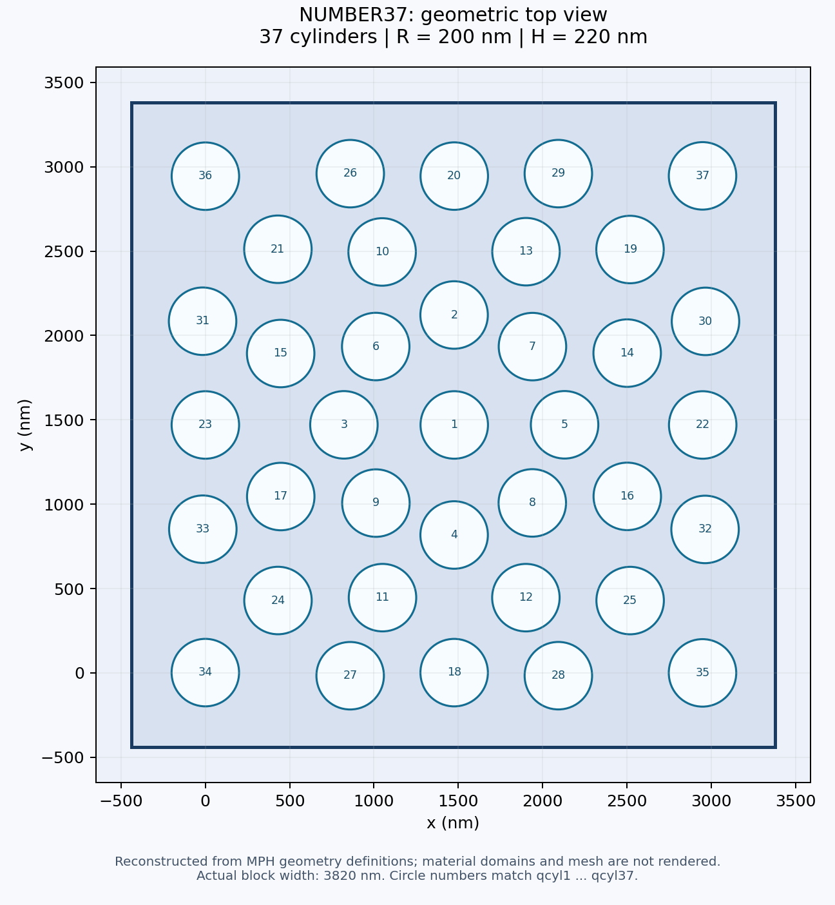

# NUMBER37 光源入射角与波长联合扫描

基于 `NUMBER37 XIE.mph` 的几何与光学材料定义，在 **COMSOL Multiphysics 6.3.0.290** 中重新建模，保留 37 个圆柱、上下介质层、周期端口与 PML。原文件由 6.4.0.293 保存，6.3 不能直接打开；本项目通过 6.3 Java API 创建新的原生模型，没有修改原文件的版本标识。

## 打开与计算

直接打开 [`models/NUMBER37_COMSOL63_angle_wavelength.mph`](models/NUMBER37_COMSOL63_angle_wavelength.mph)，选择研究 `std_angle`，点击计算。

| 设置 | 数值 |
|---|---|
| 入射角 `theta_inc` | 1°、2°、3°、4°、5° |
| 波长 `lambda0` | 1000～1500 nm，步长 5 nm，共 101 点 |
| 扫描方式 | 所有组合，共 **505 组** |
| 方位角 `phi_inc` | 0°，沿用端口已有参考坐标系 |
| 光源 | `ewfd.port1`，输入功率 1 W |
| 入射角定义 | 从入射端口法线起算，0° 为正入射 |
| 偏振 | 保留原模型 UserDefined 电场振幅 `t1x,t1y,t1z` |
| 侧边界 | `pc1`、`pc2`：Floquet，波矢来自周期端口 |
| 频率 | `c_const/lambda0` |
| 求解器 | GMRES，使用 COMSOL 自动生成的波动光学多重网格预条件器 |

在 PowerShell 中运行完整扫描：

```powershell
& .\scripts\run-sweep.ps1 -Cores 4
```

默认安装目录是 `D:\Program Files\COMSOL63\Multiphysics`；其他安装位置可加 `-ComsolRoot '你的目录\Multiphysics'`。计算结果写入 `results\时间戳\`，临时计算文件位于本项目 `work\comsol-tmp`。结果与临时文件不纳入 Git。505 组扫描保留各组场解，运行时间与磁盘占用明显高于单点验证。

结果中已配置全局计算节点 `gevrt`，表达式与原模型相同：`ewfd.Rport_1`、`ewfd.Rtotal`、`ewfd.Tport_2`、`ewfd.Ttotal`、`ewfd.RTtotal`、`ewfd.Atotal`。计算完成后，在结果的全局计算节点选择联合扫描的数据集并点击计算，即可生成表格。

## 重建结构



- 37 个圆柱：半径 `R=200 nm`，高度 `H=220 nm`，底部 `z=0`；各中心坐标完整保存在 [`docs/cylinder_positions_nm.csv`](docs/cylinder_positions_nm.csv)。
- 横向外框：`x,y ∈ [-440,3380] nm`，宽度 **3820 nm**。原参数 `Lx=Ly=3.6 µm` 没有驱动这四个长方体，实际尺寸由 `WID=3820` 决定。
- 硅：圆柱域，保留原模型折射率 **3.4** 与零消光系数。
- 石英：下层 `z=-2000～0 nm`，保留 Ghosh 1999 修正 Sellmeier 类型 2 的原始系数。
- 空气：上层 `z=0～2000 nm` 的圆柱外区域，保留原始 Mathar 折射率插值表。
- PML：上下外层 `[-2000,-1200] nm` 与 `[1200,2000] nm`；端口位于 `z=±1200 nm`。

重建得到 41 个域、243 个边界、480 条边、316 个顶点，与原始几何的实体数量一致。重建过程中校验上下层域和端口的包围盒后才复用原选择。原始四个导入网格零件和未参与当前研究的历史解未迁移；当前使用的显式几何、`mesh3` 与光学材料设置已迁移。

## 复现与验证

原始文件只读副本：[`models/NUMBER37_original.mph`](models/NUMBER37_original.mph)，需要 COMSOL 6.4；日常使用请打开 6.3 重建模型。

重新生成 6.3 模型与网格：

```powershell
& .\scripts\build-model.ps1 -Cores 4
```

`RebuildNumber37.java` 是完整独立的建模代码，重建不需要 6.4，也不需要 Python。它使用 CAD 几何内核和波动光学模块；本机现有许可已实际验证通过。构建脚本自动适配项目所在目录。

需要从原始 MPH 重新提取数据或再生成 Java 源码时：

```powershell
python -X utf8 .\scripts\inspect_model.py
python -X utf8 .\scripts\generate_rebuild.py
python -X utf8 .\scripts\verify_package.py
```

几何图脚本 `plot_structure.py` 另需 matplotlib；俯视图根据几何定义绘制，不是 COMSOL 网格或场分布截图。

验证记录保存在 [`validation`](validation)：

重复单点验证可运行 `& .\scripts\smoke-test.ps1 -Cores 4`，不会修改 505 组扫描模型；验证用场解写入 `work\NUMBER37_smoke_solved.mph`。

- `rebuild.log`、`rebuild-console.txt`：原生 6.3 重建与网格日志。
- `package-verification.json`：原始与重建几何、材料、端口、Floquet 设置及文件哈希核对。
- `smoke.log`、`smoke-console.txt`、`smoke-rt.csv`：实际 1°、1470 nm 单点计算，使用完整 114,597 单元网格。
- `load-check.log`：6.3 拒绝读取原始 6.4 文件的版本错误记录。

**505 组联合扫描已配置，尚未全部求解。** 单点通过不代表完成网格收敛性验证或原模型物理精度验证。

## 沿用原模型的物理范围

原模型仅配置两个基本周期端口，没有高阶衍射端口或正交偏振端口。这里保留该设置，因此 `Rtotal`、`Ttotal` 统计已配置端口模式；在这个 3.82 µm 超胞和所扫波段中，不能将 `1-Rtotal-Ttotal` 直接解释为吸收。需要全衍射功率时，应进一步增加相应传播阶次或独立计算总通量。

空气材料原始插值表覆盖 1.3～2.5 µm；1000～1295 nm 沿用原模型的外推设置。硅的常数折射率也按原模型保留，未改成其他材料数据库。

官方设置依据：[周期结构与入射角](https://doc.comsol.com/6.3/doc/com.comsol.help.woptics/woptics_ug_modeling.5.10.html)、[Floquet 周期条件](https://doc.comsol.com/6.3/doc/com.comsol.help.woptics/woptics_ug_optics.6.35.html)、[6.3 面网格复制 API](https://doc.comsol.com/6.3/doc/com.comsol.help.comsol/comsol_api_mesh.49.061.html)。
